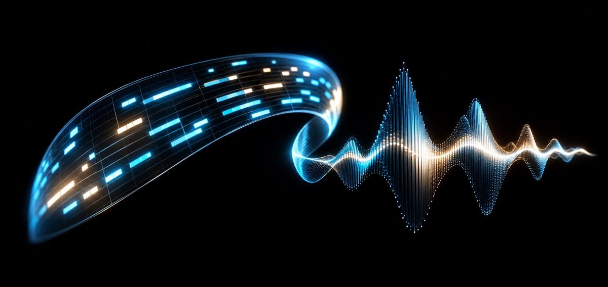

# motifdiff

Random notes are not a composition, they are a cat on a keyboard. motifdiff writes an actual MIDI file and then grades itself against exactly that cat.

[](https://github.com/ahmeddoghri/motifdiff/actions/workflows/tests.yml)


[](https://adoghri.com/project-24.html)



A lot of "AI music" demos hit shuffle and call it creativity. motifdiff uses a
masked, iterative denoising loop over MIDI pitch tokens, filling in notes
around fixed anchors and nudging everything toward a chord progression, then
scores the result against a random baseline instead of just trusting that it
sounds good because a computer made it.

## Run it

```bash
git clone https://github.com/ahmeddoghri/motifdiff
cd motifdiff
pip install -e ".[dev]"
python -m motifdiff.benchmark
```

The benchmark writes a MIDI file at `artifacts/motifdiff.mid` and a metrics
JSON file next to it, so you can both listen to the evidence and read it.

## Verified benchmark

Generated locally with `python -m motifdiff.benchmark`:

```text
metric             guided   random
scale_adherence      1.00     0.46
motif_reuse          0.07     0.00
tonal_anchor         0.50     0.08
mean_leap            3.90     9.87
```

The guided sequence stays in key 100% of the time against the random
baseline's coin-flip 46%. Mean melodic leap drops from 9.87 semitones to
3.90, which is the difference between a melody and someone falling down a
flight of stairs onto a piano.

**Update:** two things inflate that gap that have nothing to do with the
denoising algorithm. Half of the 64 steps are a hand-written 8-note motif
copied in verbatim, not generated at all. And `scale_adherence` is
guaranteed to be 1.00 for any output `generate()` can produce, because its
candidate pool is pre-restricted to in-scale pitches; `random_sequence`
draws from an unrestricted 30-pitch chromatic range, so most of that
1.00-vs-0.46 gap is a candidate-space difference, not an algorithm
difference. `python -m motifdiff.benchmark_v2` isolates what the
weighting actually contributes once both are removed. Details below.

## What gets measured

- Scale adherence, so the notes belong to the key instead of just near it.
- Motif reuse, so the piece remembers what it already said.
- Tonal anchor, so downbeats land on chord tones instead of wherever.
- Mean melodic leap, so the contour stays singable by an actual human throat.

## Half the "generated" sequence isn't generated

`generate()` writes a hand-composed 8-note motif directly into the
sequence at four fixed offsets, transposed by 0 or +5 semitones. Of the 64
steps in the published benchmark, exactly 32 are copied verbatim from that
motif, never touched by the transition-and-chord-weighted denoising step
at all. Only the other 32 are actually produced by the algorithm.

Separately, `score_sequence`'s `scale_adherence` metric checks whether a
note's pitch class is in C major. `generate()`'s candidate pool
(`[REST, 60, 62, 64, 65, 67, 69, 71, 72, 74]`) is already restricted to
exactly those pitch classes, so scale_adherence is 1.00 for any output the
generator could possibly produce, guaranteed by construction, zero credit
due to any weighting. `random_sequence` draws from an unrestricted
30-pitch range across two and a half octaves, so the 1.00-vs-0.46 headline
is mostly a candidate-space difference dressed up as an algorithm result.

```bash
python -m motifdiff.benchmark_v2
```
```
metric              generated_only   fair_random
scale_adherence              1.000         1.000
tonal_anchor                 0.433         0.333
mean_leap                    4.431         5.315

published 'guided' (seed=12, includes the hardcoded motif anchor):
  scale_adherence=1.00  tonal_anchor=0.50  mean_leap=3.90
```

`generated_only` strips the hardcoded motif out of a `generate()` output
entirely, crediting the algorithm only for the steps it actually produced.
`fair_random` draws uniformly from the exact same restricted candidate
pool, no motif, no weighting, the correct apples-to-apples baseline.
Averaged over 50 seeds for stability: scale_adherence ties at 1.000 either
way (tautological, proves nothing), but tonal_anchor and mean_leap do show
a real, positive, reproducible edge for the actual weighting, roughly 0.10
and 0.9 semitones respectively. That's genuine signal, just far smaller
than the published guided-vs-random gap implies, since half of that gap
came from hand-written content and the rest was measured against a
baseline that couldn't have scored well no matter how it was generated.

`generator.py`/`benchmark.py` are untouched, so the published table above
still reproduces exactly; `benchmark_v2.py` is the honest companion
measurement.

## Research trail

- Generating symbolic music from natural language prompts, 2024: https://arxiv.org/abs/2410.02084
- MidiCaps and symbolic music captions, 2024: https://arxiv.org/abs/2406.02255
- GraphMuse symbolic music graph processing, 2024: https://arxiv.org/abs/2407.12671
- Hierarchical symbolic pop music generation, 2024: https://arxiv.org/abs/2409.08155

## Tests

```bash
pytest -q
ruff check .
```

MIT © Ahmed Doghri
